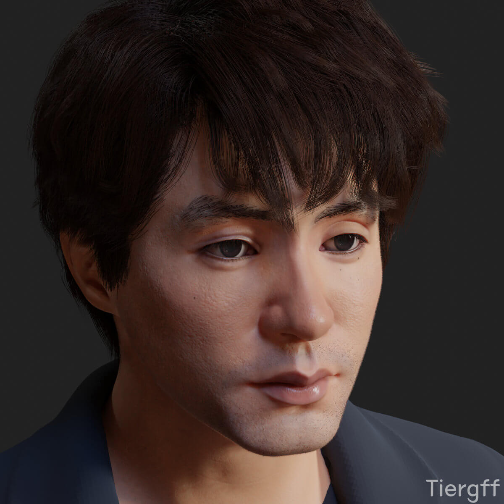
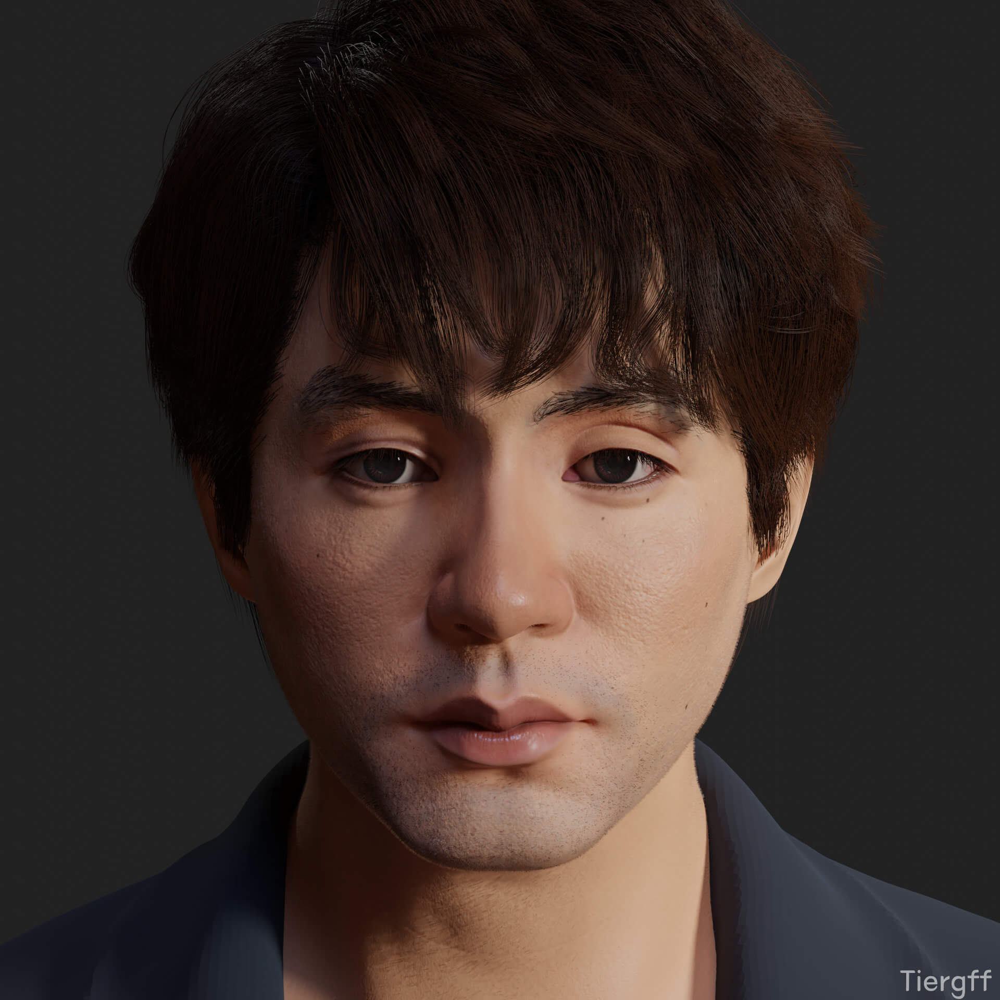
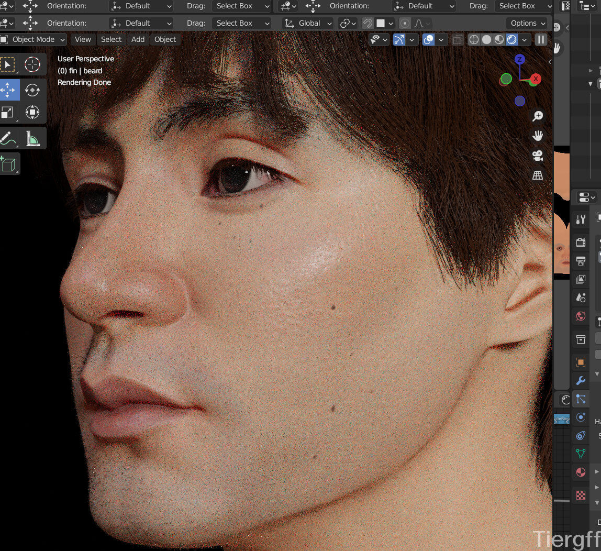
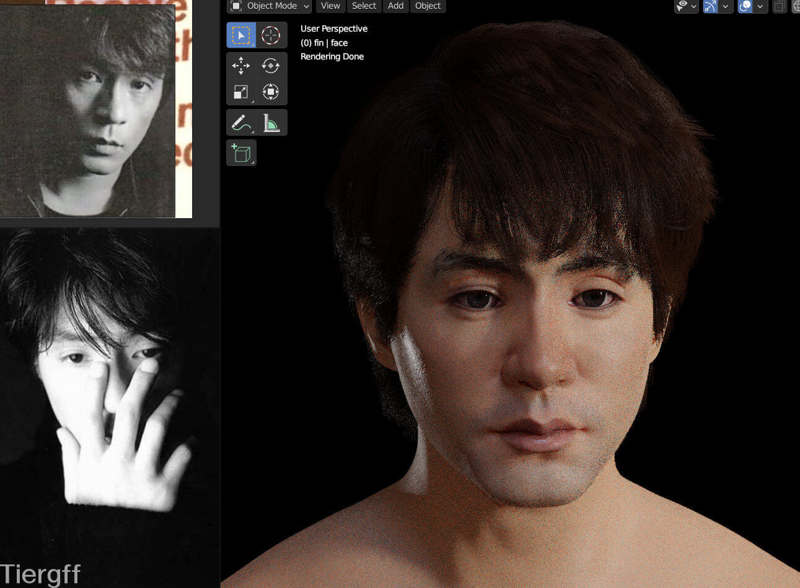
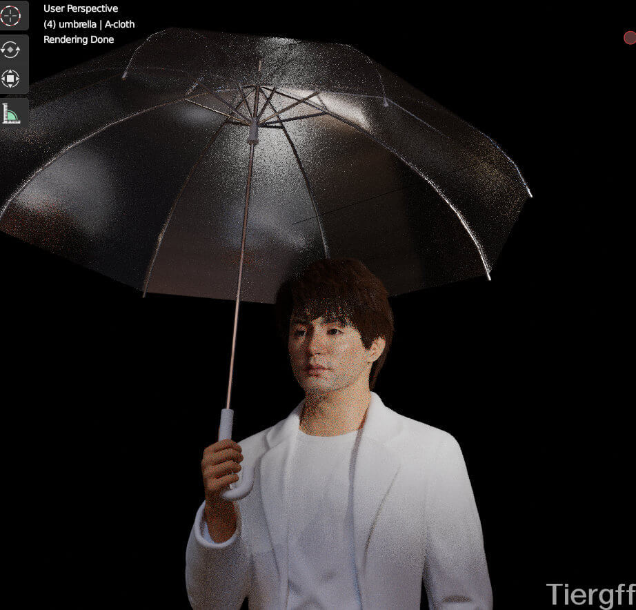
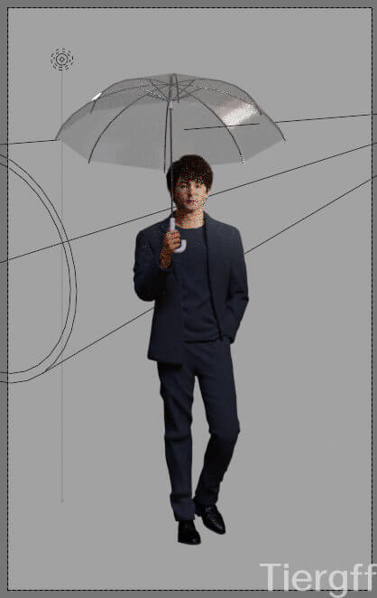
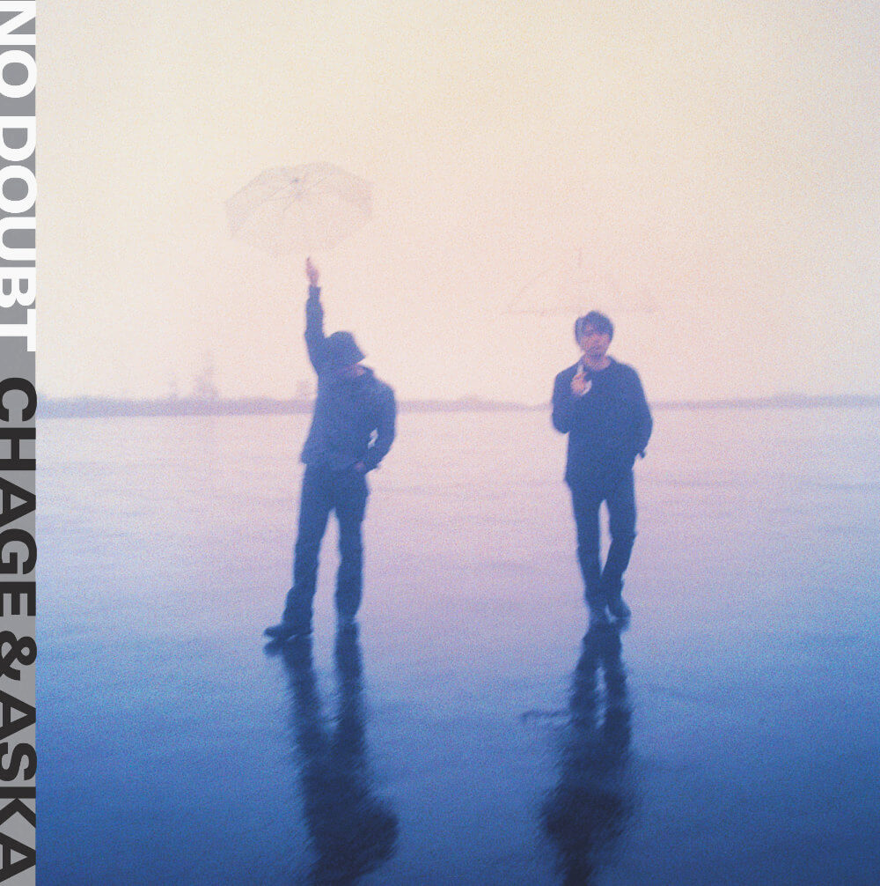

## 说明

　　2021.06.28 Cycles渲染

　　说起来整个6月都在雕他，中间有几天雕了阿獠。

　　不容易啊，终于做出第一个写实人物。不过现在再看，这还不够写实，很多面部结构都没雕出来，毕竟那时候解剖理解的还不细，咳咳…… 现在也不太行……

　　不过只要抓住几个关键点，这个人的感觉就出来了。

　　发型是之前《On Your Mark》男主头发，直接拿过来用的。


  
  


## 过程图、参考图


  
  
  
  
  
