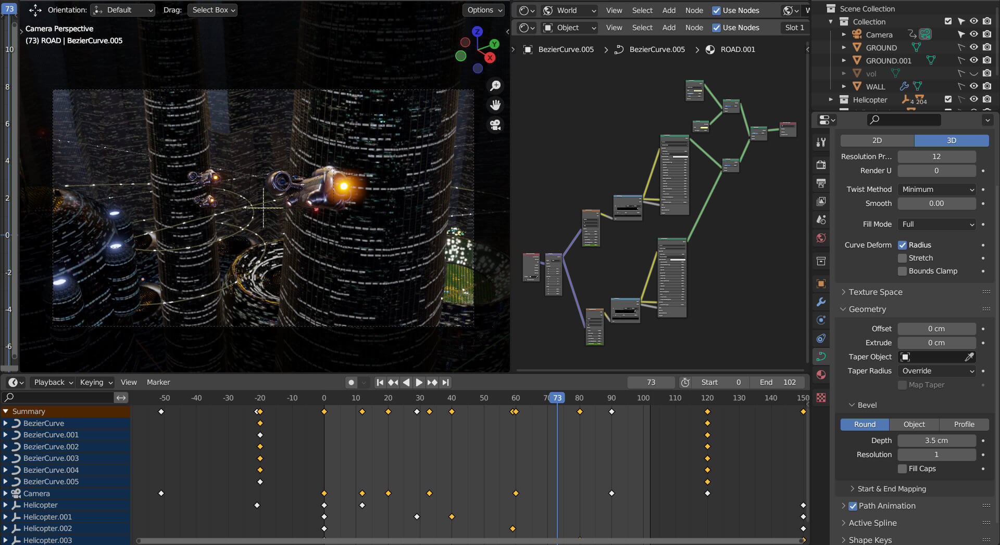
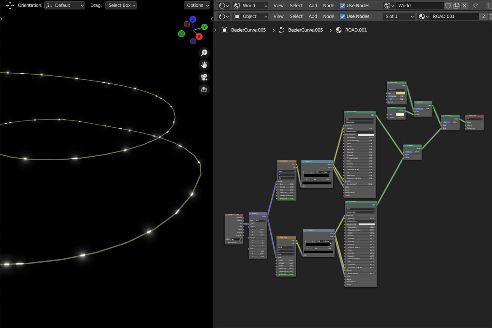
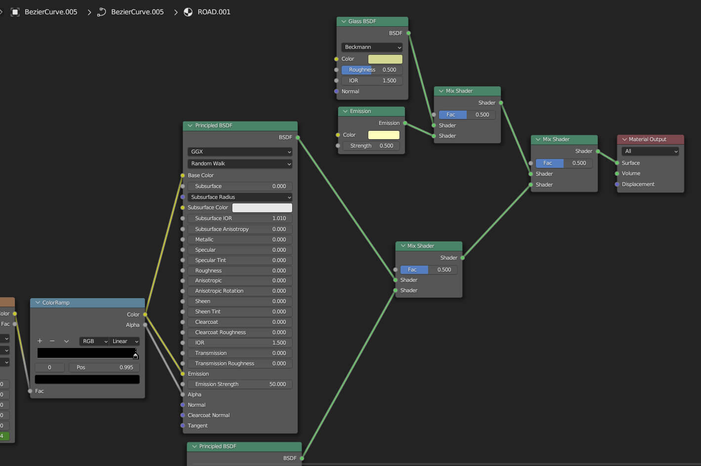
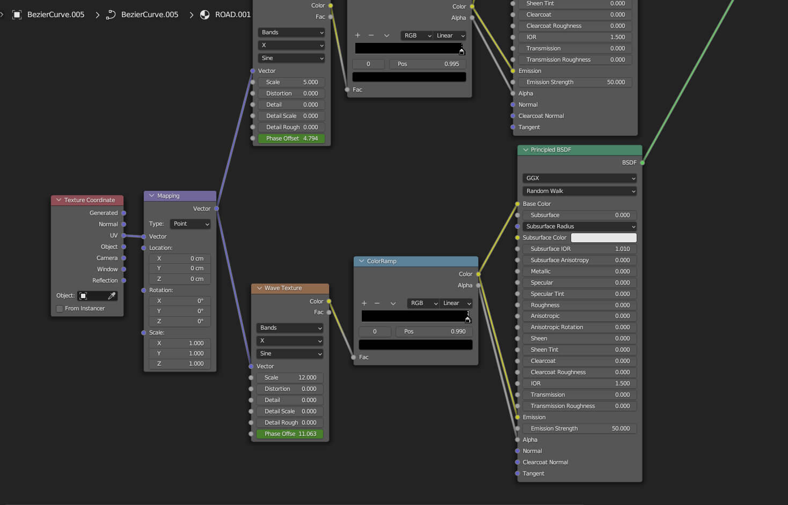
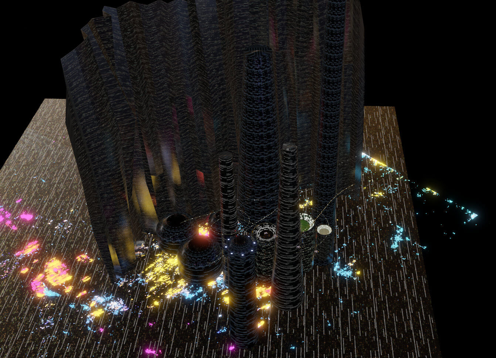
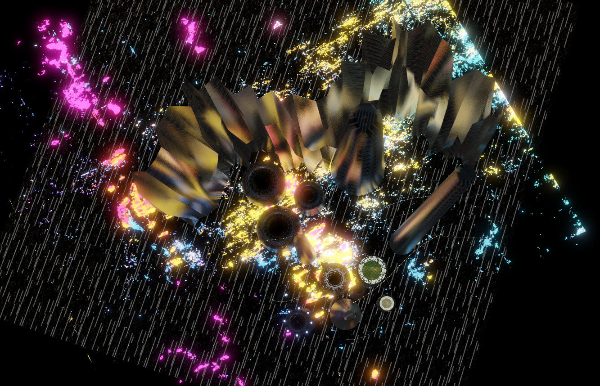
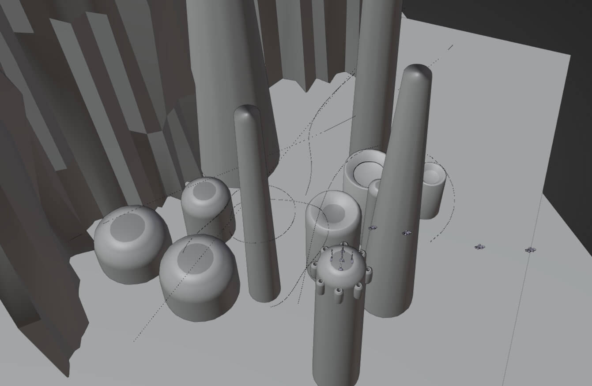

## 说明

　　2023.05.31 Eevee渲染

　　嗯…… 只是短暂重启，制作了两个镜头，再次暂停。

{{< carousel images="{featured.jpg,01.jpg,02.jpg}" aspectRatio="16-9" interval="2000" >}}



## 过程图、参考图

　　空中交通管道算是个好玩一点的材质，先是总体给它一个半透的黄绿色玻璃材质，然后叠上不同间距的发光体当作车灯，近看肯定是不行啦，远看效果还是不错的。


  
  
  


　　整体场景，地面用发光的斑块表示地面上拥挤的城市灯光，远看效果还行。


  
  
  

