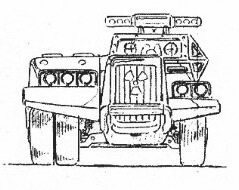
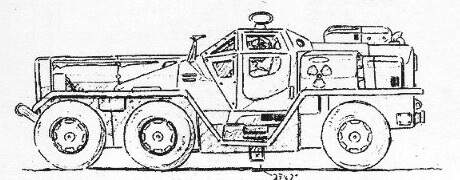
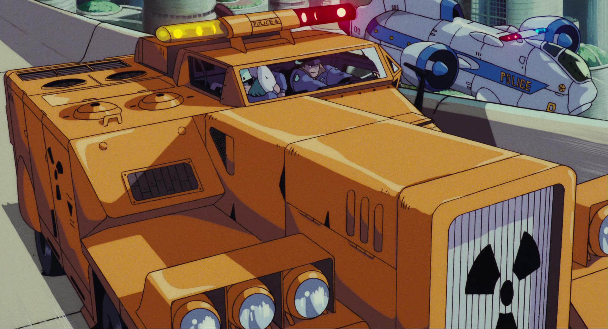
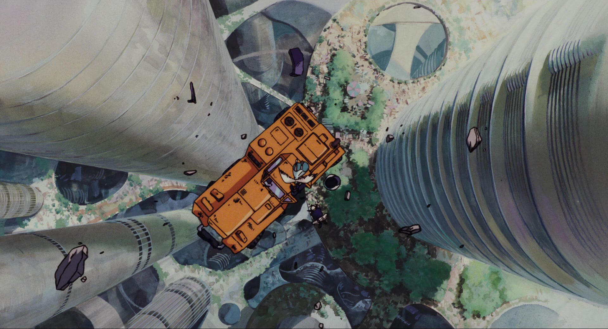

## 说明

　　2021.03.04 Eevee渲染

　　这个建模倒是不难，感觉做的还行，材质部分弄了很多磨损做旧的效果，最后出来的效果还算满意。

{{< carousel images="{featured.jpg,01.jpg,02.jpg}" aspectRatio="16-9" interval="2000" >}}

## 过程图、参考图


  
  
  
  
  


