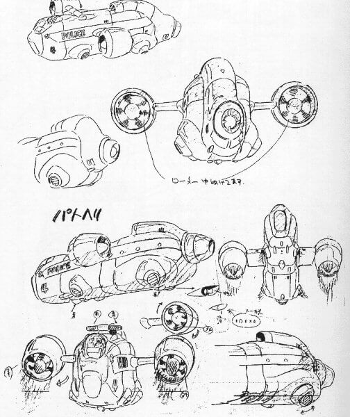
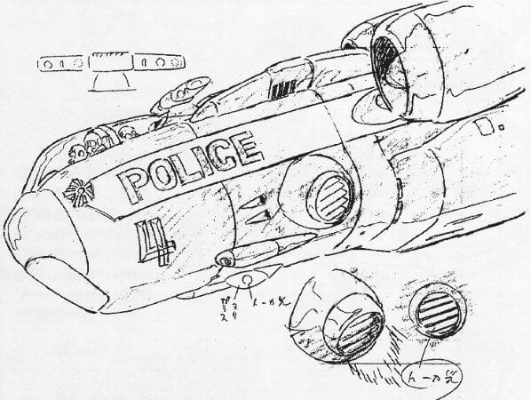

## 说明

　　2021.01.05 Eevee渲染

　　当时刚学Blender，快捷键还有材质一窍不通，UV也不会，反正就硬着头皮做出来的。

　　现在再看，做的像玩具飞机了，哈哈。

{{< carousel images="{featured.jpg,01.jpg,02.jpg,03.jpg}" aspectRatio="16-9" interval="2000" >}}

## 过程图、参考图


  
  


