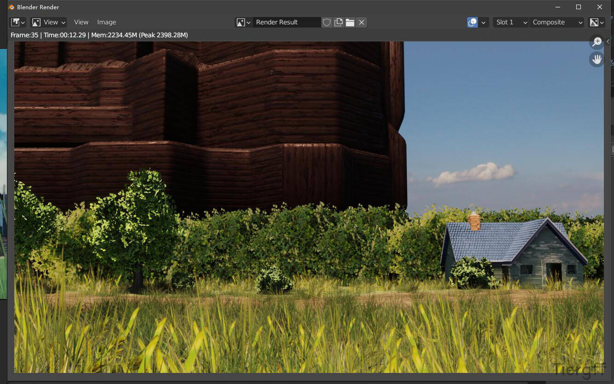
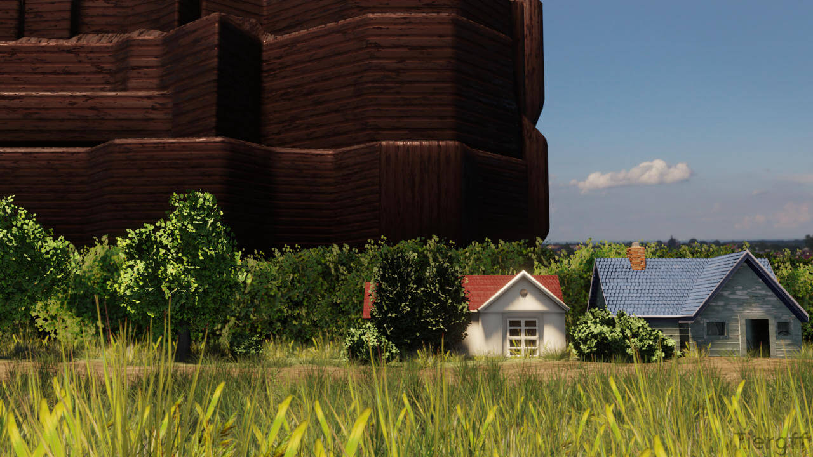
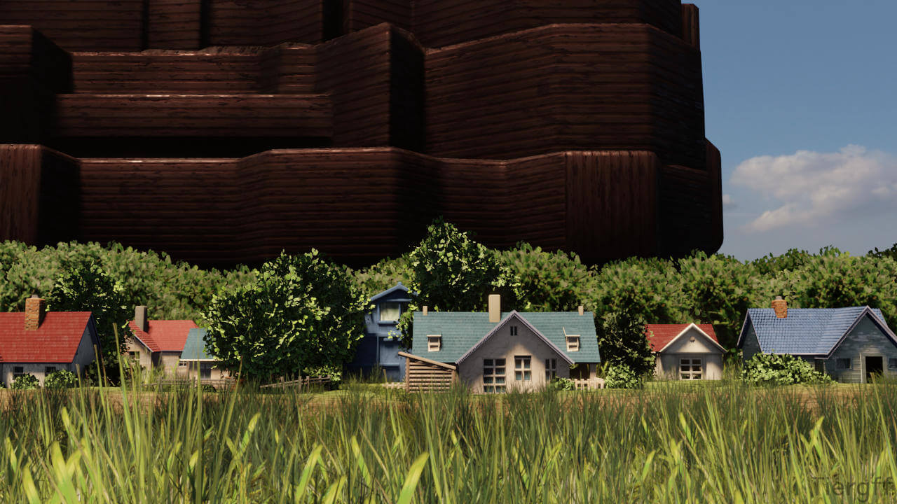
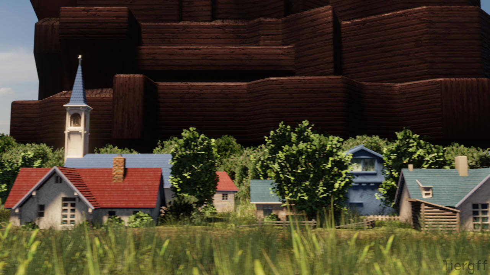
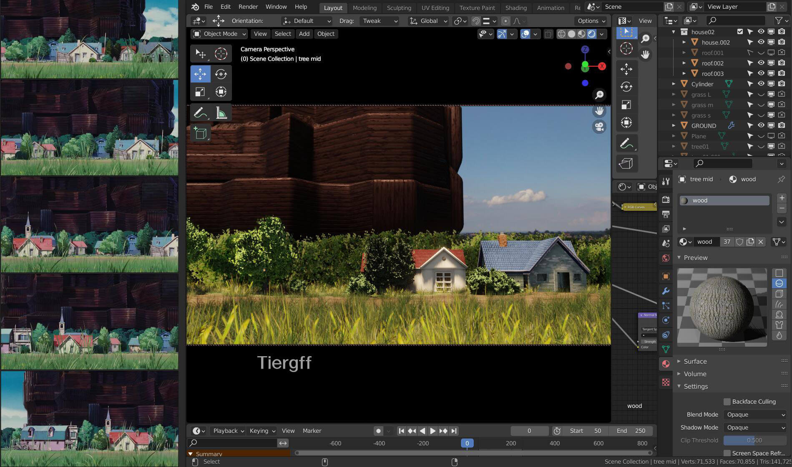
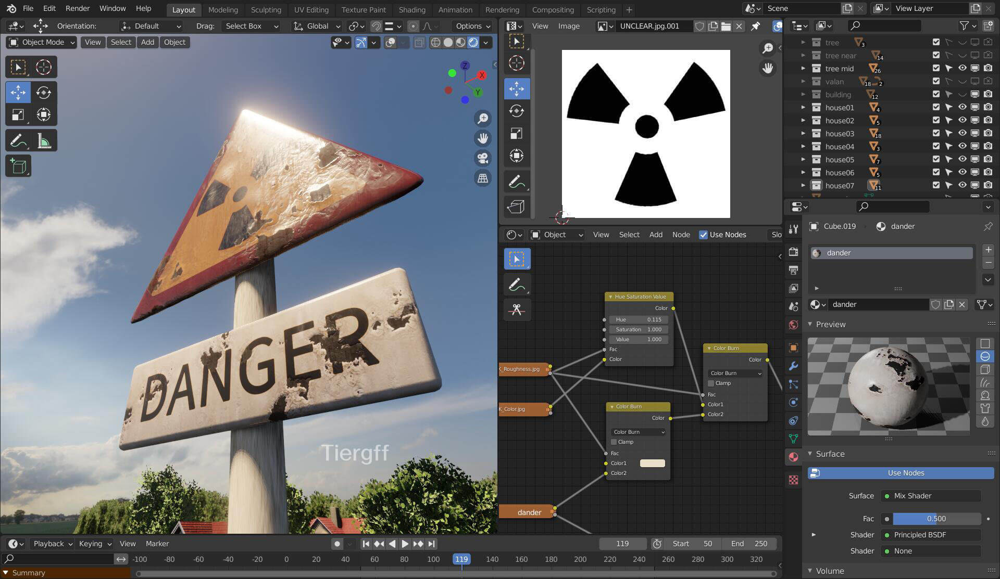
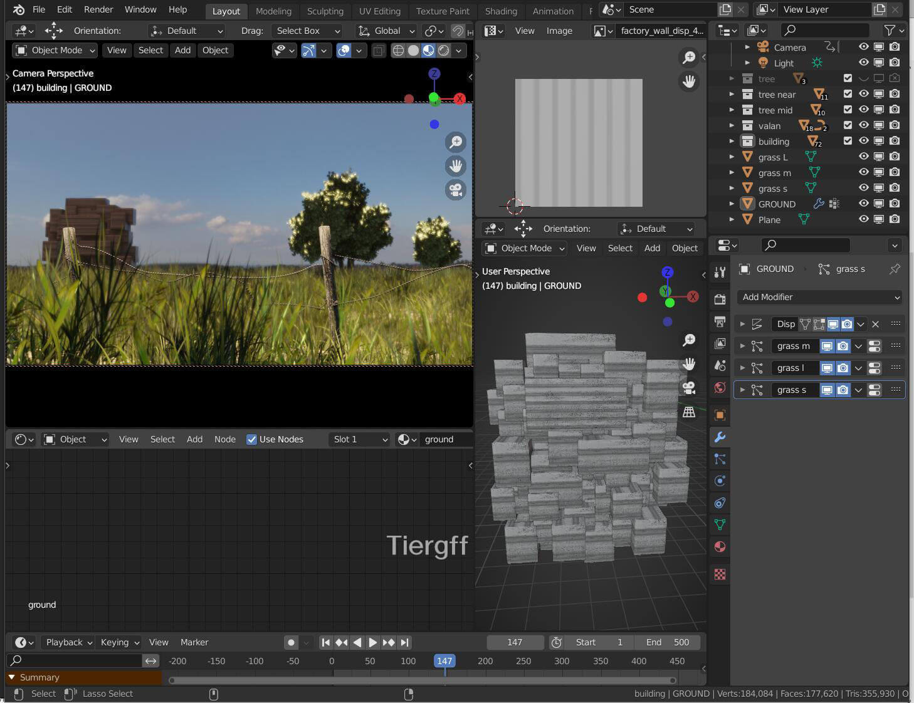
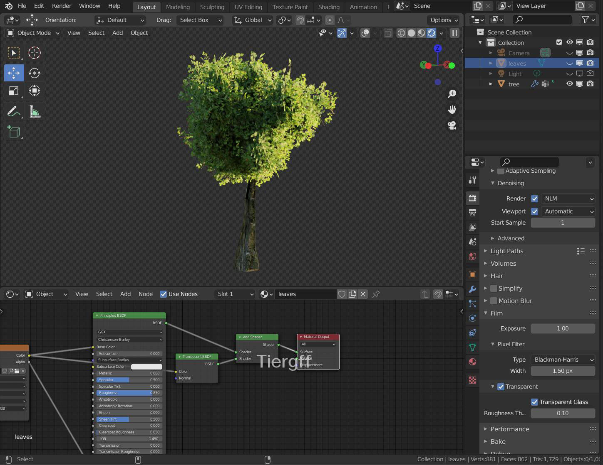

## 说明

　　2021.10.31 Eevee渲染

　　终于做了第一段小动画，成就感满满！

　　可惜那时候不懂景深、雾场还有运动模糊是什么，要是开了这些效果会更好！

　　这个动画是复刻不完了，后面的场景太大，做的累……

{{< carousel images="{featured.jpg,02.jpg,01.jpg}" aspectRatio="16-9" interval="2000" >}}



## 过程图、参考图


  
  
  
  
  
  
  
  
  


## 原作欣赏

