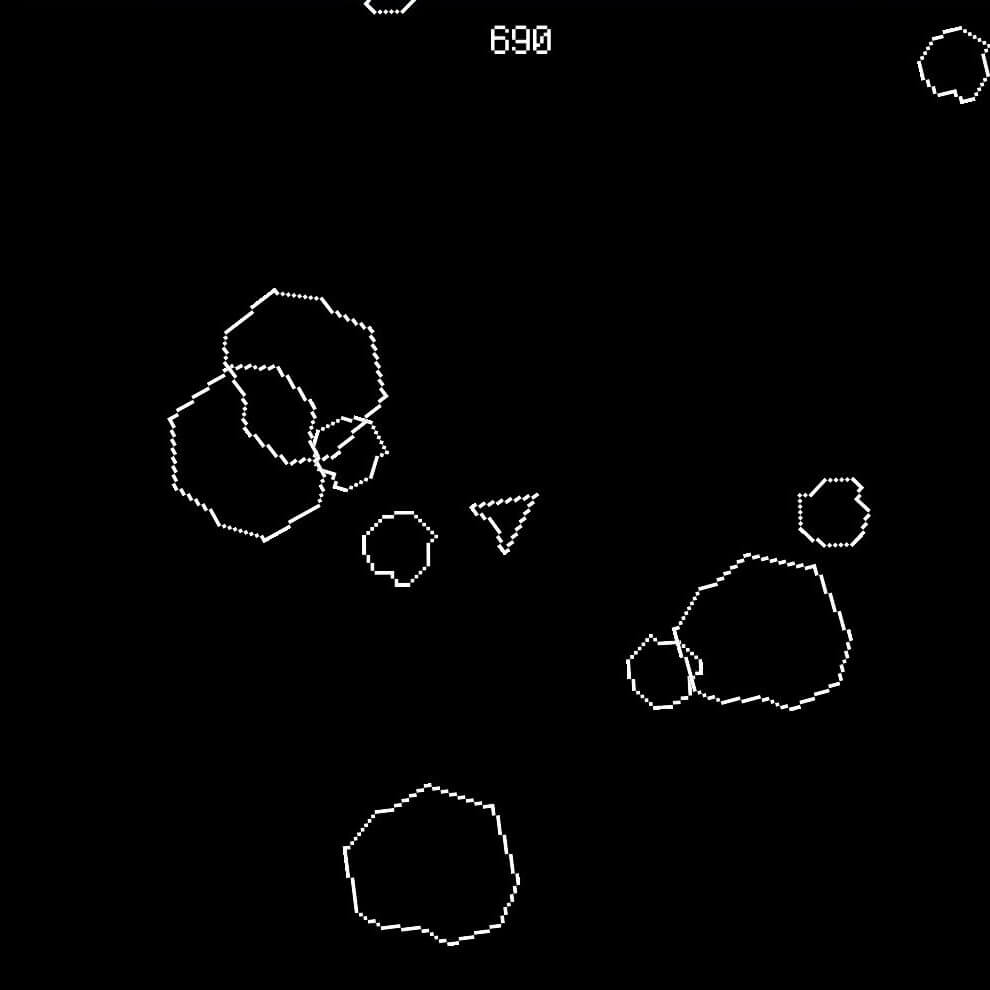

## 说明

　　经过将近两年的休整，我打算进攻游戏制作领域了！看了一个月游戏引擎，也试着上手了一些，最后决定用GameMaker制作游戏。

　　说起GameMaker引擎可以追溯到10年前，也就是2015年的时候，当时我有短暂研究过游戏制作，那时接触到的是GameMaker 8还有RPG Maker XP。当时的我对编程非常恐惧，安装了GameMaker后摸了两下就放弃了，转而使用更加冷门的Action Game Maker（好像和现在新出的Action Game Maker不是一家吧）。当时硬生生做出了一个简单的小游戏，人物可以行走跳跃，还能攻击小怪，之后因为临近毕业忙着找工作，也就把这些东西放下了。

{{< carousel images="{1.png,2.png}" aspectRatio="16-9" interval="2000" >}}
 

　　如今再捡起游戏制作，主要还是想把我构思的故事用游戏这种媒介表达出来，我之前尝试用动画还有小说来表达，可惜动画因为繁重的工作量而放弃了，小说因为文笔怎么写也练不出来而停滞了，或许制作游戏更适合我？我也说不好，不如趁着年轻多去尝试吧！

　　如今30岁的我已经不那么惧怕编程了（多少还是有些头疼），没准游戏编程应该不会很难吧！游戏剧本应该不用像小说那样需要文笔吧！人物动画应该不用做动画那样K那么多动作吧！人物模型也不像雕刻那样细致吧！所以说，或许制作游戏真的是很好的一种方式呢！

## 第一个游戏

　　非常经典的飞机打岩石游戏《Space Rocks》，全程跟着教程做，基本能完美复刻出来，是非常好的开始！

 


下载试玩


