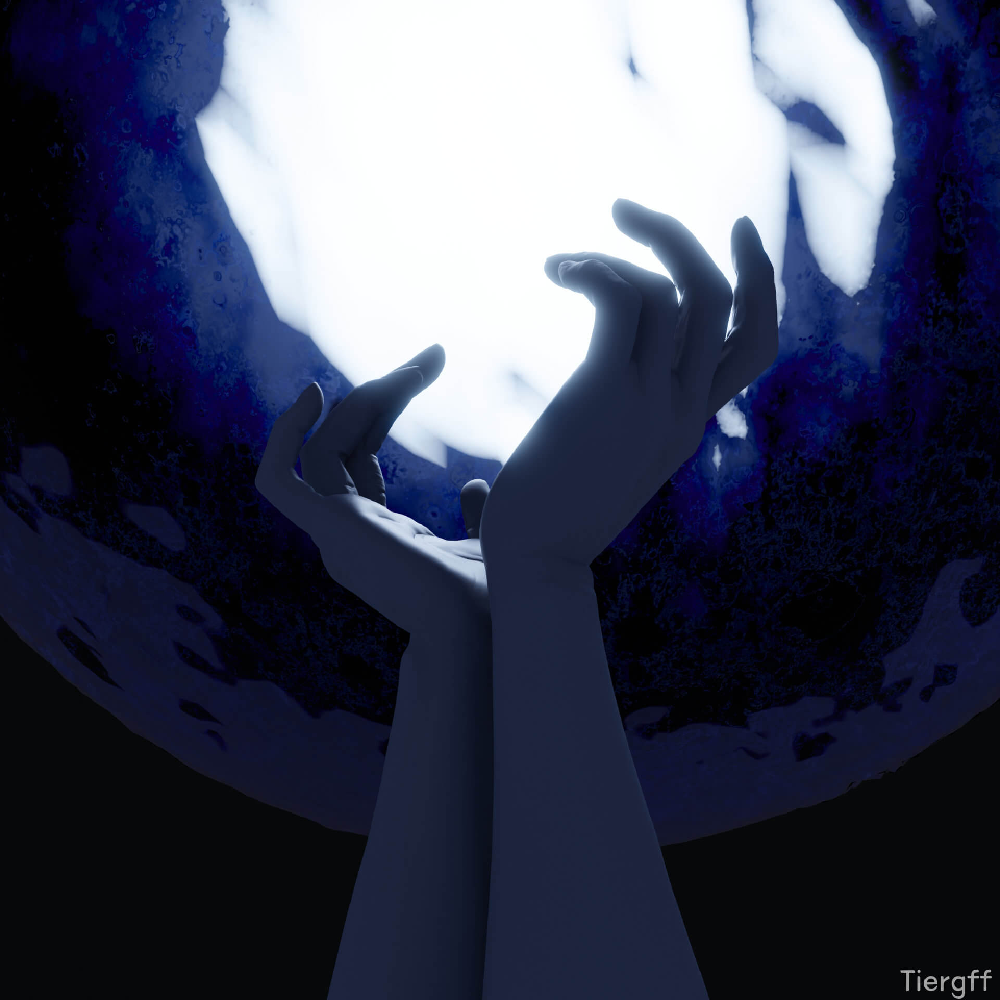
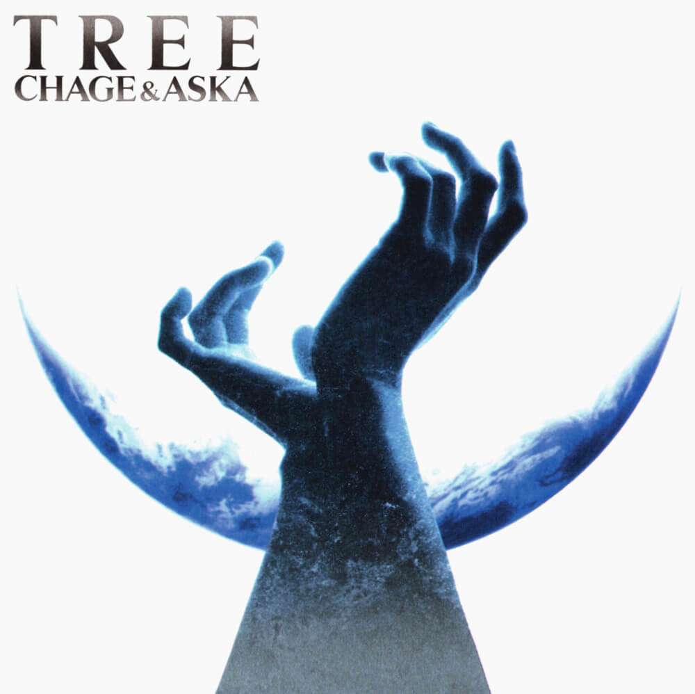
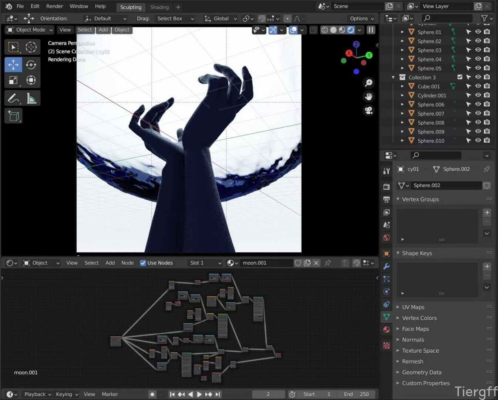
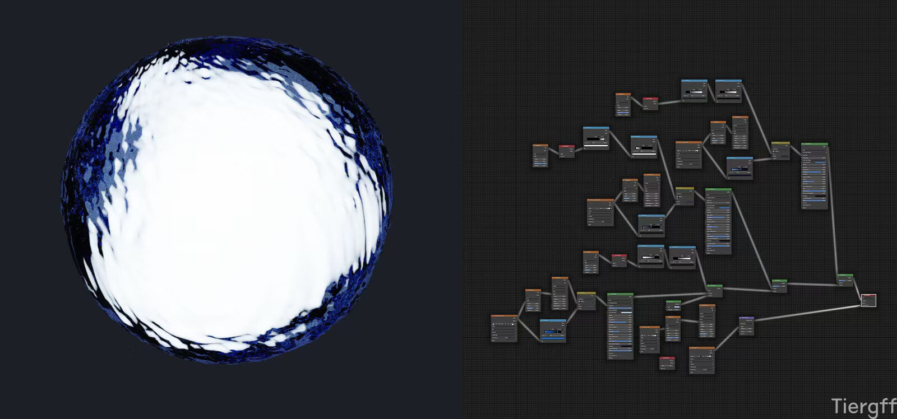
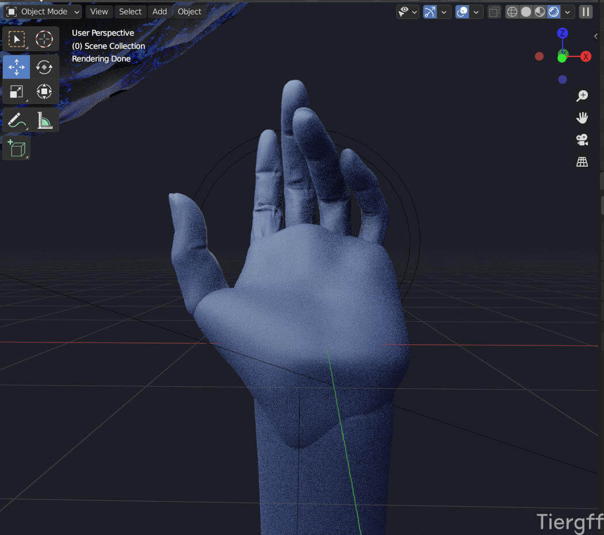

## 说明

　　2021.03.27 Cycles渲染

　　第一次雕成人物后，但我并不是很满意，因为我一直想雕写实人物！

　　这次是手部的写实雕刻练习，嗯…… 只雕了一半…… 现在再看，手掌那里太平了。

　　材质方面，主要是后面那个球挺复杂的，一开始做材质时按着Eevee渲染方式做的，后来觉得效果不好，又改成了Cycles渲染，还是CY可玩性高一些。


  
  


## 过程图、参考图


  
  
  
  


